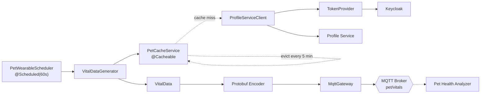
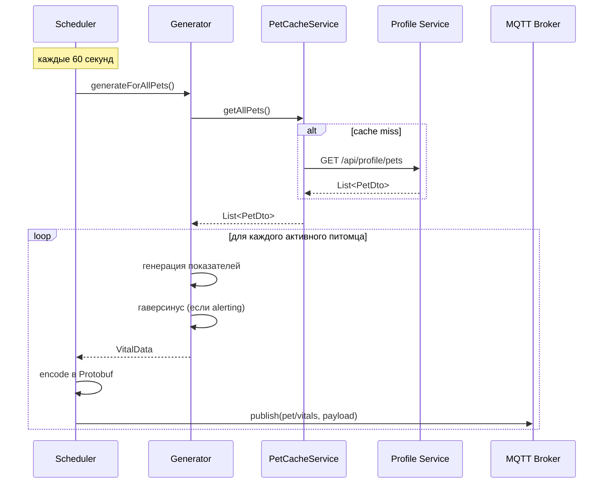

# 📡 Pet Wearable Service


> Эмулятор умных ошейников: генерирует физиологические и геолокационные данные питомцев и публикует их в MQTT-топик в формате Protocol Buffers.

---

## 📋 Назначение

**Pet Wearable Service** имитирует работу сети носимых устройств (умных ошейников), закреплённых на домашних животных. Сервис играет роль **источника телеметрии** для всей платформы: он периодически генерирует реалистичные показатели состояния питомцев и публикует их в единую шину сообщений.

В реальной эксплуатации этот сервис был бы заменён на MQTT-мост, принимающий данные с физических устройств. В учебном проекте он выполняет ту же роль, но данные синтезируются с использованием физиологически правдоподобных диапазонов.

Ключевые задачи:

- получение списка питомцев с активными ошейниками из Profile Service;
- генерация показателей пульса, дыхания, температуры и координат;
- расчёт расстояния от домашней зоны по формуле гаверсинуса;
- сериализация данных в **Protocol Buffers**;
- публикация сообщений в MQTT-топик `pet/vitals` каждые 60 секунд.

Сервис **не имеет REST API** и не хранит данные в БД — он работает исключительно как фоновый издатель.

---

## ✨ Ключевые возможности

### Генерация физиологически правдоподобных данных

`VitalDataGenerator` формирует показатели в реалистичных диапазонах:

| Показатель | Норма | Аномалия |
|---|---|---|
| Пульс | 60–120 уд/мин | 180–220 уд/мин (шанс **1%**) |
| Дыхание | 15–30 дых/мин | — |
| Температура | 37.5–39.2 °C | — |

С вероятностью **1%** пульс «уходит» в зону тахикардии (180–220 уд/мин) — это позволяет downstream-сервису (Pet Health Analyzer) регулярно получать аномальные данные для тестирования детекторов.

### Учёт параметров ошейника

Для каждого питомца проверяется флаг `collar.active` — если ошейник неактивен, данные не генерируются. Дополнительно учитывается `collar.homeInfo.alerting`:

- если **alerting = false** — генерируются только физиологические показатели без геолокации;
- если **alerting = true** — рассчитываются координаты и расстояние до дома.

### Геолокация по формуле гаверсинуса

Координаты питомца формируются как случайное смещение от «домашних» координат в пределах **±2 км** (в градусах — `±0.02`). Далее по упрощённой формуле гаверсинуса вычисляется расстояние:

```
R = 6371 км
dLat, dLon — в радианах
a = sin²(dLat/2) + cos(lat1)·cos(lat2)·sin²(dLon/2)
c = 2·atan2(√a, √(1−a))
distance = R · c
```

Полученное значение сравнивается в Health Analyzer с `distanceLimit`, заданным владельцем.

### Сериализация в Protocol Buffers

Сообщения передаются в компактном бинарном формате Protobuf согласно схеме `VitalDataProto.proto`:

```proto
message VitalDataMessage {
    string pet_id = 1;
    string species = 2;
    string breed = 3;
    int32 heart_rate = 4;
    int32 respiration = 5;
    double temperature = 6;
    Location location = 7;
    int64 timestamp = 8;
}

message Location {
    double lat = 1;
    double lon = 2;
    double distance_from_home = 3;
    int32 distance_limit = 4;
}
```

Protobuf обеспечивает **в 3–10 раз меньший размер** сообщения по сравнению с JSON, что критично для потоковой передачи данных с тысяч устройств.

### Кэширование списка питомцев

`PetCacheService` использует **Spring Cache** (`@Cacheable`) для избежания частых запросов к Profile Service. Список обновляется принудительно каждые **5 минут** через `@CacheEvict`:

```java
@Cacheable(value = "allPets", unless = "#result == null || #result.isEmpty()")
public List<PetDto> getAllPets() { ... }

@Scheduled(fixedDelay = 300_000)
@CacheEvict(value = "allPets", allEntries = true)
public void evictCache() { ... }
```

Это снижает нагрузку на Profile Service и ускоряет цикл генерации: при 10 000 питомцев вместо 10 000 HTTP-запросов в минуту выполняется лишь один раз в 5 минут.

### Периодическая публикация

`PetWearableScheduler` запускается с фиксированной задержкой **60 секунд** (`fixedDelay = 60_000`). Для каждой итерации:

1. Получает список активных питомцев из кэша.
2. Генерирует `VitalData` для каждого.
3. Конвертирует в Protobuf-сообщение.
4. Публикует в MQTT через `MqttGateway`.

Обработка каждого питомца обёрнута в `try/catch`: сбой при публикации одного сообщения не прерывает цикл.

---

## 🛠 Технологический стек

| Компонент | Технология |
|---|---|
| Язык | Java 21 |
| Фреймворк | Spring Boot 3 |
| Интеграция | Spring Integration (MQTT) |
| Брокер | Eclipse Mosquitto |
| Формат данных | Protocol Buffers 3 |
| Кэш | Spring Cache (ConcurrentMap) |
| Планировщик | Spring `@Scheduled` |
| Безопасность | Spring Security OAuth2 Client, Keycloak |
| Логирование | SLF4J + Logback |
| Контейнеризация | Docker (multi-stage build) |

---

## 🏗 Архитектура сервиса



---

## 📁 Структура проекта

```
pet-wearable-service/
├── src/main/java/ru/sibsutis/pet_wearable/
│   ├── PetWearableApplication.java
│   ├── api/
│   │   ├── client/
│   │   │   ├── ProfileServiceClient.java
│   │   │   └── TokenProvider.java
│   │   └── dto/
│   │       └── PetDto.java                # DTO питомца из Profile Service
│   └── core/
│       ├── generator/
│       │   └── VitalDataGenerator.java    # Генерация телеметрии
│       ├── model/
│       │   ├── Location.java
│       │   └── VitalData.java
│       └── service/
│           ├── MqttGateway.java           # Spring Integration gateway
│           ├── PetCacheService.java       # @Cacheable + evict
│           └── PetWearableScheduler.java  # @Scheduled публикация
├── src/main/proto/
│   └── vital_data.proto                   # Protobuf-схема
├── src/main/resources/
│   └── application.properties
├── Dockerfile
├── build.gradle
└── README.md
```

---

## 📡 Публикация данных

Сервис **не предоставляет REST API** — вся работа идёт через MQTT-канал.

### Формат сообщений

**Топик:** `pet/vitals`
**Формат:** Protocol Buffers (бинарный)
**Схема:** `VitalDataProto.VitalDataMessage`

Пример содержимого (в декодированном виде для наглядности):

```json
{
  "petId": "81e9f1d3-e878-448b-812f-12237b030faa",
  "species": "dog",
  "breed": "poodle",
  "heartRate": 95,
  "respiration": 22,
  "temperature": 38.3,
  "location": {
    "lat": 82.95123,
    "lon": 55.01321,
    "distanceFromHome": 0.34,
    "distanceLimit": 10
  },
  "timestamp": 1735700400
}
```

### Подписка на топик (для отладки)

```bash
# С помощью mosquitto_sub
mosquitto_sub -h localhost -p 1883 -t "pet/vitals" -v

# С помощью MQTTX или другого клиента
```

Для декодирования Protobuf можно использовать `protoc --decode=ru.sibsutis.pet_wearable.proto.VitalDataMessage vital_data.proto < payload.bin`.

---

## 🗄 Модель данных

### Внутренняя модель `VitalData`

| Поле | Тип | Описание |
|---|---|---|
| `petId` | String | ID питомца |
| `species` | String | Вид |
| `breed` | String | Порода |
| `heartRate` | Integer | Пульс, уд/мин |
| `respiration` | Integer | Дыхание, дых/мин |
| `temperature` | Double | Температура, °C |
| `location` | Location | Координаты (опционально) |
| `timestamp` | Long | Unix-время (секунды) |

### Вложенный объект `Location`

| Поле | Тип | Описание |
|---|---|---|
| `lat` | Double | Широта |
| `lon` | Double | Долгота |
| `distanceFromHome` | Double | Расстояние от дома, км |
| `distanceLimit` | Integer | Разрешённый радиус, м |

### Кэш Spring

| Имя кэша | Что хранится | Инвалидация |
|---|---|---|
| `allPets` | Список питомцев из Profile Service | Каждые 5 минут (`@Scheduled` + `@CacheEvict`) |

---

## 🔄 Ключевые сценарии

### Полный цикл публикации



### Генерация с тахикардией

1. Генерируется случайный пульс из диапазона 60–120.
2. С вероятностью **1%** значение перезаписывается на 180–220.
3. Остальные показатели остаются в норме.
4. Сообщение публикуется — Health Analyzer детектирует аномалию.

### Работа с геозоной

1. Проверяется `collar.homeInfo.alerting`.
2. Если **false** — генерируются только физиологические показатели, `location = null`.
3. Если **true** — к домашним координатам добавляется случайное смещение (`±0.02`), рассчитывается расстояние, формируется объект `Location`.

---

## ⚙️ Конфигурация

### Переменные окружения

| Переменная | Назначение | Значение по умолчанию |
|---|---|---|
| `MQTT_HOST` / `MQTT_PORT` | MQTT-брокер | `localhost` / `1883` |
| `GATEWAY_HOST` / `GATEWAY_PORT` | API Gateway (для вызовов Profile Service) | `localhost` / `8888` |
| `KEYCLOAK_ISSUER_URI` | Issuer URI Keycloak | `http://localhost:8080/realms/clinic-realm` |
| `KEYCLOAK_CLIENT_SECRET` | Секрет клиента `pet-wearable-service` | — |

### Настройка MQTT-каналов Spring Integration

Требуется два бина (в `MqttConfig`):

- `mqttOutboundChannel` — `MessageChannel` для исходящих сообщений;
- `MqttPahoMessageHandler` — обработчик, публикующий сообщения в брокер.

---

## 🚀 Запуск

### Локально (Docker Compose)

```bash
docker compose up -d pet-wearable-service mosquitto profile-service keycloak
```

### Запуск только сервиса

```bash
cd services/pet-wearable
./gradlew bootRun
```

### Сборка образа

```bash
docker build -t pet-wearable-service:latest .
```

### Проверка работы

```bash
# Проверить, что публикация идёт
mosquitto_sub -h localhost -p 1883 -t "pet/vitals" -v

# Логи сервиса
docker logs -f pet-wearable-service
```

---

## 🔗 Связанные сервисы

| Сервис | Взаимодействие |
|---|---|
| **Profile Service** | Источник списка питомцев и параметров ошейников |
| **MQTT Broker** | Принимает публикуемые сообщения в топик `pet/vitals` |
| **Pet Health Analyzer** | Подписан на топик, обрабатывает телеметрию |
| **Keycloak** | Выдаёт токены для вызова Profile Service |

---
